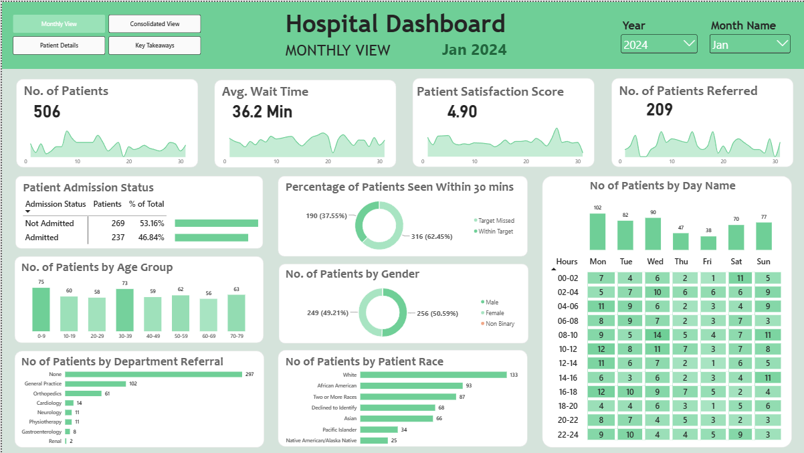
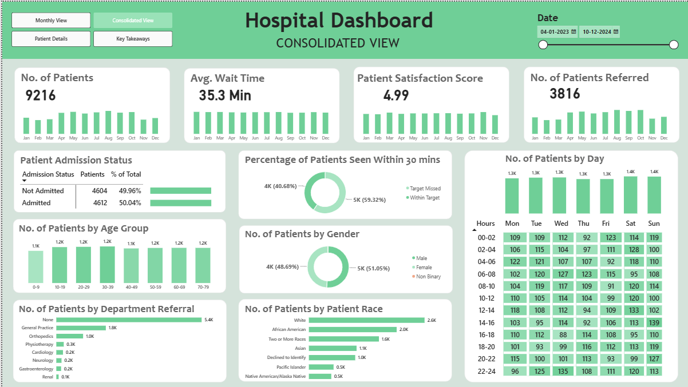
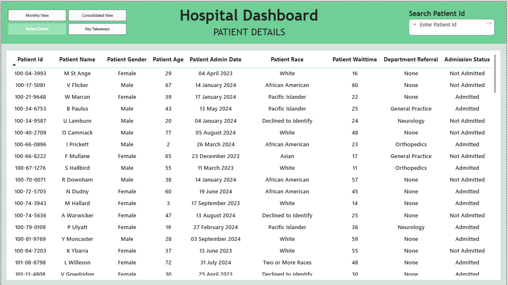
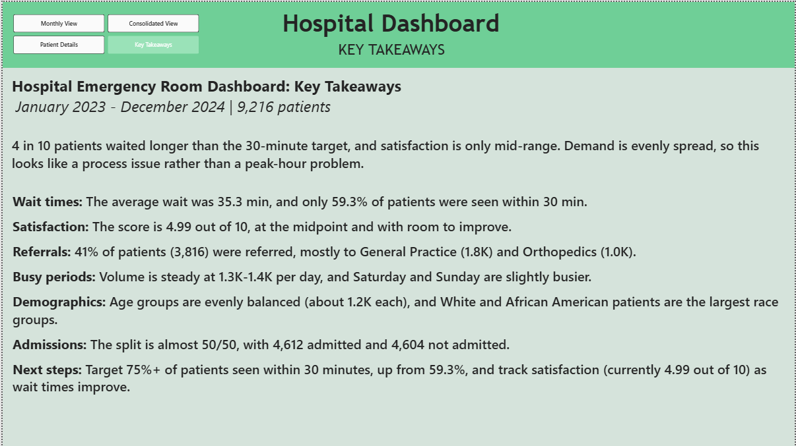
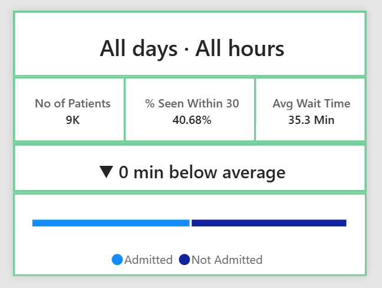

# Hospital Emergency Room Dashboard (Power BI)

An interactive Power BI report analyzing 9,216 emergency room patient records
from January 2023 to December 2024, built to explore wait times, patient
satisfaction, referrals and demand patterns.

> Note: this uses a sample dataset for portfolio purposes. It contains no real patient data.

## Key findings
- Average wait time was 35.3 minutes, and only 59.3% of patients were seen within the 30-minute target.
- Patient satisfaction averaged 4.99 out of 10.
- 41% of patients (3,816) were referred, mostly to General Practice and Orthopedics.
- Patient volume is evenly spread across days and age groups, which points to a process issue rather than a peak-hour problem.

## Report pages
| Page | What it shows |
|---|---|
| Monthly view | KPIs, admission status and demographics for a selected month |
| Consolidated view | KPIs, admission status and demographics across the full period |
| Patient details | Record-level table with filters |
| Key takeaways | Written summary of findings and next steps |

## Features
- Page navigator for moving between views
- Custom hover tooltip on the day/hour heatmap showing patients, average wait, % seen within 30 minutes and admission split
- Date slicers and month/year filters

## Screenshots

## Tools
Power BI Desktop, DAX, data modeling

## Files
- `Hospital_ER_Dashboard.pbix`: the full report (open with Power BI Desktop)
